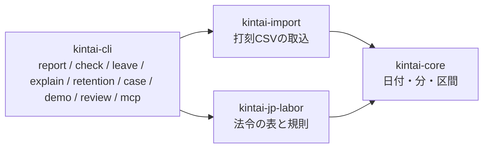

# 設計の判断: 純粋な計算の核、根拠つきの日付表、対応外は拒否、別実装との照合

コードを読めば分かることは書きません。ここに残すのは、なぜその形にしたか、何を捨てたか、どこに限界があるかです。

## 全体の形

`kintai-core` と `kintai-jp-labor` は、ファイルも通信も持たない純粋な計算です。入出力は `kintai-import` と `kintai-cli` に閉じ込めます。勤怠サービスを自作したい開発者が、法令の読みの部分だけを借りられるようにするためです。reviewは同じJSONをHTMLに埋め込み、mcpは同じJSONの控えを起動時に作ります。計算の規則をブラウザや連携先に複製しません。保存と打刻用サーバーは Phase 1 で、この外側に足します。

## 日付と時刻は自前の小さな型にする

`kintai-core` は外部の依存を持ちません。日本にはサマータイムがなく、必要なのは暦の日付、曜日、分単位の足し引きだけです。時刻の汎用ライブラリが持つタイムゾーンや書式は要りません。依存を増やすと、監査と最小のRustバージョンの管理の対象が増えます。

**限界**: 自前の暦計算は誤りやすい。試験の側で `chrono` と全日付を突き合わせ（開発時のみの依存）、入力の範囲を2000〜2099年に絞ります。型は、年休の失効日のような計算の結果のために、1900〜2200年を持てるようにしてあります。

## 時間は整数の分で持ち、浮動小数点は使わない

区分の計算は、すべて整数の分です。打刻の秒は、取込の時点で方針に従って分にします。既定は、始業を切り捨て・終業を切り上げて、実際の労働時間を下回らないようにする方法です（根拠と限界は[打刻の仕様](spec/punch.md)）。1日ごとの端数の切り捨ては、通達が認めていません。1か月の合計への30分単位の丸めだけを、設定で選べます。

## 法令の規則は、根拠つきの日付表にする

割増の率、36協定の上限、年次有給休暇の付与日数は、`kintai-jp-labor` の定数と表に置き、各値に、条項、e-Gov の版ID、確認日を持つ根拠（`provenance`）を付けます。今は適用期間を持たず、日付で切り替わるのは、2023-04-01 の前後の60時間超の率だけです。改正で値が変わるときは、適用期間つきの表へ移し、過去の日付の結果は変えません。計算の結果には、使った根拠と確認日が付き、`kintai explain` が日ごとに文章で説明します。

## 解釈が割れる点と、対応外は、黙って決めない

解釈が割れる点（法定休日を特定していないとき、勤務が休日・週・月の境界をまたぐときなど）は、設定にするか、対応外として拒否します。既定は拒否で、黙って片方の読みを採りません。対応外の働き方（変形労働時間制、フレックスなど）は、通常制として黙って計算せず、必ずエラーにします。黙って計算すると、結果が法令違反を隠すためです。

## 計算の正しさは、3つの別の方法で確かめる

公的資料にある数値例を、そのまま試験にします。Rust の実装（区間の演算）とは別に、1分ずつ数える素朴な Python の実装を、仕様だけから別の担当に書かせ、無作為の入力で突き合わせます。実装の見えない側から書かせるのは、仕様の読み違いを実装が引きずらないようにするためです。最後に、わざと誤りを入れて試験が赤くなるかを見る変異試験を、境界の規則に対して行います。

**限界**: 3つとも、同じ仕様の読みを前提にしています。読みそのものの誤りは、専門家の確認でしか見つかりません。

## 捨てた案

| 案 | 捨てた理由 |
|---|---|
| 秒単位で計算する | 賃金台帳の項目が時間単位で、秒の端数が結果に残ると、1か月の丸めの規則と噛み合わない |
| 1日ごとに端数を切り捨てる | 通達が認めていない |
| 休憩を自動で控除する | 黙って控除すると、休憩の不足（法令違反）が見えなくなる。記録された休憩を引き、不足は警告する |
| 日付と時刻の汎用ライブラリを使う | 上記のとおり、要らない機能が多く、監査の対象が増える |
| SQLで集計する | 区分の規則が条件分岐の塊で、表で書くと読めない。純粋な関数にして試験する |
